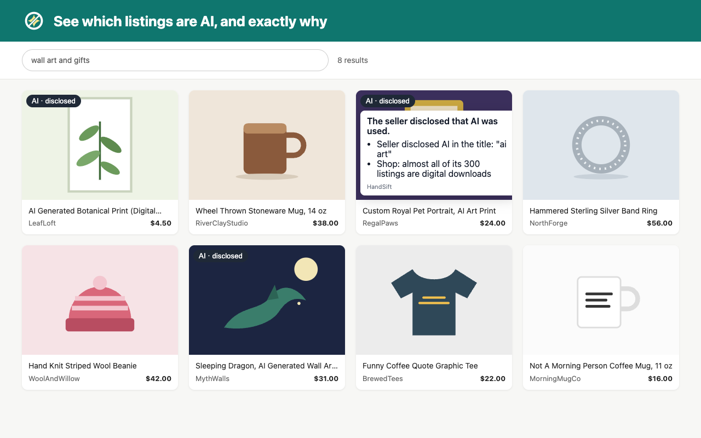
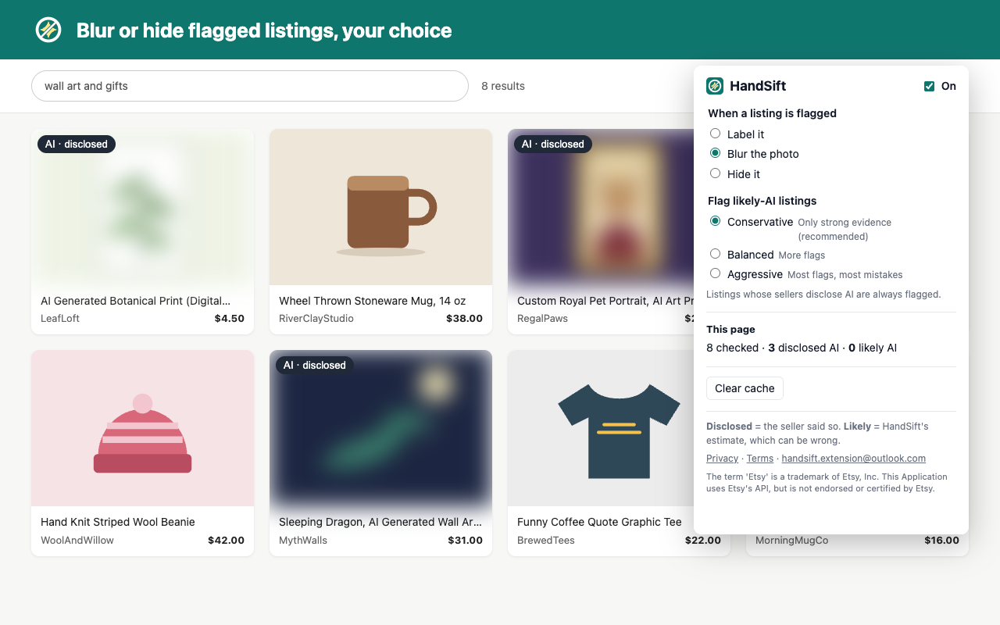
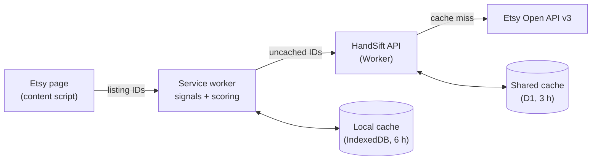

<div align="center">


# HandSift

**See which Etsy listings are AI-made, and why.**

A free Chrome extension for Etsy shoppers who want handmade work. It labels AI-generated
listings in search results and shop pages, and always shows its reasons.

[](https://github.com/Djang27/HandSift/actions/workflows/ci.yml)
[](https://github.com/Djang27/HandSift/releases)


[Website](https://djang27.github.io/HandSift/) ·
[Privacy policy](https://djang27.github.io/HandSift/privacy.html) ·
[Terms](https://djang27.github.io/HandSift/terms.html) ·
[Changelog](CHANGELOG.md)



</div>

## Features

- **Two kinds of labels.** **AI · disclosed** means the seller says AI was used, in the title,
  description, tags, or materials. **Likely AI** means there's no disclosure but several clues add
  up; that's HandSift's estimate, and it can be wrong. The two always look different.
- **Always explains why.** Hover or tap a label to see the exact reason, like the phrase the
  seller used.
- **Label, blur, or hide.** Keep flagged listings visible with a badge, blur their photos (with a
  one-click reveal), or remove them from the results.
- **You choose how cautious it is.** Conservative (the default), Balanced, or Aggressive.
- **Built to avoid wrongly flagging artists.** Anti-AI statements ("no AI used") are ignored, and
  no single weak clue is ever treated as proof.
- **Private by design.** Only the ID numbers of the listings on the page are sent, and nothing at
  all until you accept the terms on first run.

<div align="center">

</div>

## Install

HandSift is **in review on the Chrome Web Store**. The install link will be here once it's live.
Release builds only work when installed from the store (the API accepts HandSift's store ID).

## How accurate is it?

Measured on 107 hand-labeled listings (October 2026; details in [docs/scoring.md](docs/scoring.md)):

| Setting                | Precision | Seller-disclosed AI caught | Undisclosed AI caught | Human listings wrongly flagged |
| ---------------------- | --------- | -------------------------- | --------------------- | ------------------------------ |
| Conservative (default) | 100%      | 22 / 22                    | 0 / 21                | 0 / 64                         |
| Balanced               | 100%      | 22 / 22                    | 0 / 21                | 0 / 64                         |
| Aggressive             | 100%      | 22 / 22                    | 1 / 21                | 0 / 64                         |

In plain terms: **HandSift reliably catches sellers who disclose AI, and it hasn't mislabeled a
human-made listing in testing.** It does **not** yet catch most undisclosed AI, because that
usually shows only in the photos, which HandSift doesn't analyze. 107 labels is a small sample,
so read these as directions, not guarantees.

## How it works



- The extension reads only listing **IDs** from the page; it never scrapes listing content.
- The Worker holds the Etsy API key (never shipped in the extension), looks listings up through
  Etsy's official API, and caches them so repeat lookups cost Etsy nothing.
- **Signals** (`descriptionDisclosure`, `designedBy`, `shopHeuristics`) each look for one kind of
  evidence. A disclosure makes a listing "AI · disclosed"; the weaker clues combine into a score
  that must pass your sensitivity's threshold for "Likely AI".
- Everything stays within Etsy's API terms: official API only, minimum data, freshness limits
  (6 hours for listings, 24 hours for shops), and written authorization for a browser extension.

## Development

Requires Node 24+ and pnpm 12.

```sh
pnpm install
pnpm check      # format, lint, types, unit tests, architecture rules
pnpm test:e2e   # the extension in real Chromium, against a mock API
pnpm eval       # accuracy on data/labels.csv

pnpm --filter @handsift/extension build:staging   # build against staging
pnpm --filter @handsift/worker dev                # local API (your own Etsy key)
```

| Part                 | Stack                                                                                      |
| -------------------- | ------------------------------------------------------------------------------------------ |
| `apps/extension`     | Chrome Manifest V3, WXT, TypeScript, React (popup, welcome page, Shadow DOM badges), Dexie |
| `apps/worker`        | Cloudflare Workers, D1 (SQLite), Workers Rate Limiting                                     |
| `packages/shared`    | Zod schemas and types shared by both, all tunables in one `config.ts`                      |
| Tests and guardrails | Vitest, Testing Library, Playwright, dependency-cruiser, ESLint, GitHub Actions            |

The code follows strict layers (UI → adapters → pure core → shared), enforced in CI. Adding a
detection signal is one new file; adding another site (say, Pinterest) is one new adapter.
Pushing a version tag deploys the API and builds the release (`.github/workflows/release.yml`).

## Support

Questions, problems, or a listing HandSift got wrong: **handsift.extension@outlook.com**, or
[open an issue](https://github.com/Djang27/HandSift/issues).

## Disclaimer

The term 'Etsy' is a trademark of Etsy, Inc. This Application uses Etsy's API, but is not
endorsed or certified by Etsy.

HandSift's "Likely AI" labels are estimates and can be wrong. Please don't treat a label as an
accusation against a seller.

© 2026 HandSift. All rights reserved. The source is public to read; no license to reuse it is
granted.
